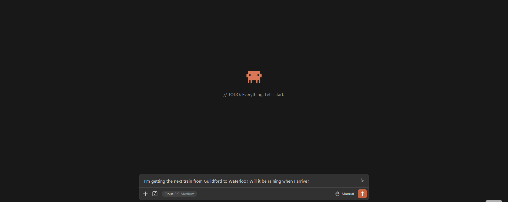

# commute-mcp

An [MCP](https://modelcontextprotocol.io/) server that lets an AI assistant
answer questions about UK train journeys and the weather when
you arrive. It uses live National Rail departure data and the Open-Meteo forecast.

- "When's the next train from Guildford to London Waterloo?"
- "I'm getting the next train from Reading to Bristol Temple Meads. Will it be raining when I arrive?"
- "What's the next train from Weybridge to Guildford?"

<!-- Record the demo and save it as docs/demo.gif -->

## Tools

| Tool | What it does |
|---|---|
| `find_stations(query)` | Looks up stations by name, including misspelt ones, and returns their three-letter CRS codes |
| `get_departures(station, destination=None)` | Next departures with platforms, delays, cancellations and arrival times at the destination. Includes rail replacement buses and disruption messages |
| `get_weather(station)` | Current weather at a station |
| `plan_journey(origin, destination)` | Next direct trains, each with its real arrival time, plus the hourly forecast at the destination until the last train arrives |

For a journey with a change, the assistant calls `plan_journey` once for each leg and picks a
connection that leaves after the first train arrives.

## Design decisions

- **One request for arrival times, not one per train:** Departure board only gives
  departure time, rather than fetching each train's details separately (1 + N requests), the server
  uses the "with details" board, which includes every train's calling points and their scheduled
  and expected times in a single request.
- **The AI plans changes over journeys:** The rail API's destination filter only finds
  direct trains. Instead of building a route planner, `plan_journey` gives real arrival times and
  the assistant chains legs together. The assistant already knows where the interchanges are.
- **Caching:** Departures are cached for 30 seconds and weather for 15 minutes, so repeated or follow-up
  questions don't hit the APIs again.

## Known limitations

- Each call only finds direct trains, journeys with changes rely on the assistant calling the
  tool once per leg.
- When a name matches several stations, the first alphabetically is used (with a note). For
  example, "Edinburgh" picks Edinburgh Gateway, not Edinburgh Waverley.
- The cache lives in memory, so it's cleared whenever the server restarts.

## Data sources and attribution

Live train data comes from the National Rail Enquiries Live Departure Board, provided by
[Rail Delivery Group](https://www.raildeliverygroup.com/) through the
[Rail Data Marketplace](https://raildata.org.uk/).

Station data (`commute_mcp/data/stations.csv`) comes from
[davwheat/uk-railway-stations](https://github.com/davwheat/uk-railway-stations),
originally from [Trainline EU](https://github.com/trainline-eu/stations) and
[their sources](https://github.com/trainline-eu/stations#licence).
It is made available under the
[Open Database License (ODbL)](https://opendatacommons.org/licenses/odbl/1-0/).

Weather data by [Open-Meteo.com](https://open-meteo.com/), licensed under
[CC BY 4.0](https://creativecommons.org/licenses/by/4.0/).
